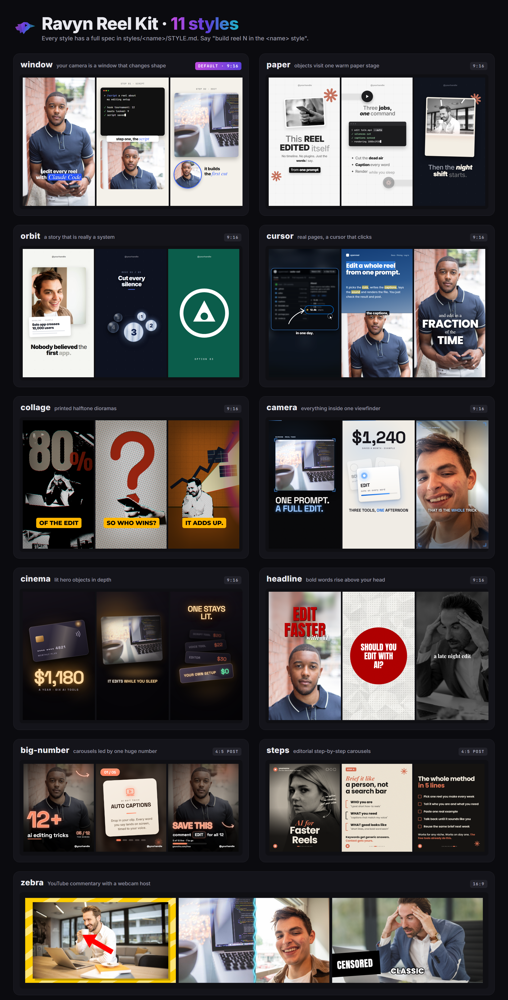

# ravyn Reel Kit

**Script, edit, caption, cover and post short-form reels with Claude Code.** A complete content
system in one folder: a topic radar, a script factory, a real video editor (ravyn), 11 styles, and
the rules that keep the quality up. Free.

Made by [@rahmanbuilds](https://www.rahmanbuilds.com) · questions and help on
[Discord](https://discord.gg/6DbpJUj8GT)



**See it work:** [docs/example-reel.mp4](docs/example-reel.mp4) is a 26-second tour of the kit, made BY
the kit: an AI voice, two free photos, built in ravyn in the paper style. Its source is in
`studio/assets/example/`, and rendering it yourself is the setup test.

## What is inside

| | |
|---|---|
| **ravyn** (`studio/ravyn/`) | a Premiere-style editor in your browser: timeline, razor, keyframes, captions timed to your voice, review notes pinned to the frame, one-click render. One reel = one project file that you and Claude edit together |
| **5 skills** (`.claude/skills/`) | topic radar, reel script, reel build, video breakdown, taste learning. You talk, Claude follows the procedure |
| **11 styles** (`styles/`) | each with a full spec and a preview image. The default, **Window**, is made for creators who show their face |
| **The brain** (`CLAUDE.md`, `rules/`) | who you are, your rules, your taste. The kit gets better every reel because your reactions become rules |
| **The craft** (`docs/`) | hooks, script rules, editing craft, render traps, posts and covers, free sound effects |
| **Tools** (`studio/tools/`) | one command turns your video into timed words and jump cuts; one command turns HTML slides into PNGs |

## Quick start

1. Install the free tools (about 20 minutes, once): **[docs/SETUP.md](docs/SETUP.md)**.
2. Open this folder in Claude Code:
   ```powershell
   cd path\to\this\folder
   claude
   ```
3. Say: **"Read CLAUDE.md and help me fill in the About me section."**
4. Then: **"Make my first reel. Walk me through it."**

To open ravyn yourself, double-click **`Open ravyn.bat`** (it opens http://localhost:3140 in your
browser; keep its window open while you edit). To test your setup in one click, double-click
**`Render example.bat`**.

Already use Claude Code? Steps 2 to 4 are all you need, plus `ffmpeg`, Node 18+ and
`pip install openai-whisper`.

Using another agent (Cursor, Codex, Gemini CLI)? It reads [AGENTS.md](AGENTS.md).

## How one reel gets made

```
find a topic  ->  write the script  ->  record yourself  ->  ingest
     ->  still board of every scene  ->  your notes  ->  ONE build in ravyn
     ->  review in ravyn, notes on the frame  ->  3-second test  ->  render  ->  cover  ->  post
```

| You say | What happens |
|---|---|
| "find me a topic" | searches your niche, scores every story, writes a brief with sources |
| "write a reel about X" | 12 hooks, the best one wins, a beat-by-beat script, captions, post copy |
| `node tools/ingest.mjs 1` | your take becomes timed words, jump cuts and a clean copy |
| "build reel 1" | a still board first, then the cut in ravyn after your notes |
| "break down this video" | any reference reel becomes measured numbers and a new style |
| "I hate that transition" | becomes a rule, after your yes, so it never happens again |

## The styles

| Style | For | |
|---|---|---|
| **window** | facecam reels: your camera is a window that changes shape | the default |
| paper | clean, warm, paper-white explainers with objects that visit one stage | |
| orbit | a story that is really a system, five bodies that light up in turn | |
| cursor | screen walkthroughs: a real page, a cursor that clicks, drawn arrows | |
| collage | printed-collage dioramas, halftone, a camera that never stops | |
| camera | everything inside one glowing viewfinder | |
| cinema | lit hero objects in depth, like a product film | |
| headline | talking head with bold words rising above it | |
| zebra | 16:9 YouTube commentary with a webcam host | 16:9 |
| big-number | carousel posts led by one huge number | 4:5 post |
| steps | editorial step-by-step carousels | 4:5 post |

Each folder has `STYLE.md` (the full spec) and `preview.png`. To make your own style from any
reel you love, use the `video-breakdown` skill.

## Folder map

```
Open ravyn.bat           double-click: opens the editor in your browser
Render example.bat       double-click: renders the example reel (your setup test)
CLAUDE.md, AGENTS.md     the brain (fill in About me first)
rules/                   your taste: TASTE.md (confirmed), PENDING.md (waiting for your yes)
.claude/skills/          the procedures
styles/                  the styles
docs/                    setup and craft
scripts/  briefs/        your scripts and topic briefs
studio/                  the video project: ravyn/, tools/, fonts/, sfx/, assets/, projects/, renders/
```

## Licence

Free to use, not for resale. Use it for anything, including paid client work, and the videos you
make are yours to sell. You may not sell the kit itself or charge for it. Full terms in
[LICENSE](LICENSE). Fonts are SIL Open Font License and preview photos are CC0: details in
[CREDITS.md](CREDITS.md).
