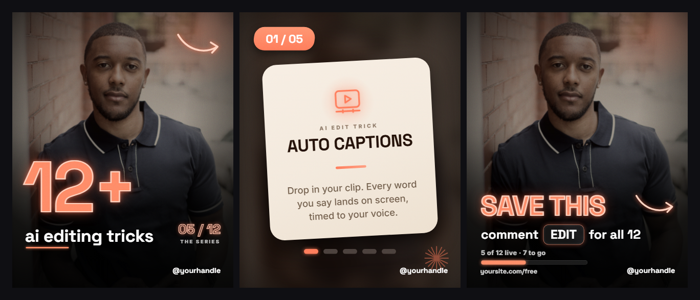

# Style: BIG NUMBER

A carousel post style built around one giant glowing number. The cover is your photo with a huge
coral number and a quiet lowercase title. The middle slides are warm cream cards, one item per
slide, floating on a blurred copy of the cover. The last slide asks for the save. It works best
for list posts: "12 tools", "7 prompts", "50 tricks", released as a series you count up over time.

**Format:** carousel post, 4:5, 1080 x 1350 per slide. Works on Instagram and LinkedIn.
**You need:** one photo of yourself (chest up, looking at the camera, with some empty space below
your chin), a real list of items with a one-line description each, and a keyword people can comment.

**How to build it:** say "make a carousel in the big-number style about <topic>". Claude writes one
HTML file per slide (1080 x 1350, fonts from `studio/fonts/`) into `studio/posts/<slug>/`, then
`node tools/shoot.mjs posts/<slug>` (from `studio/`) turns every slide into a PNG. Full recipe:
`docs/POSTS.md`.

## The post shape

Always the same seven slides:

| Slide | Type | What is on it |
|---|---|---|
| 1 | **COVER** | Your photo, the giant number, the lowercase title, the series fraction |
| 2 to 6 | **ITEM** (5 of them) | One item per slide, on a cream card |
| 7 | **CTA** | Your photo again, SAVE THIS, the comment keyword, the progress bar |

**Rules:**

1. **One item per slide.** Never a list slide. The swipe is the reward.
2. **The cover is type only.** Giant number plus lowercase title. No title boxes, no floating cards,
   no stickers on the cover.
3. **Your face is never covered, on any slide, the CTA included.** Text and decorations live in the
   side columns or start below your chin. Check the actual export: eyes, nose, mouth and chin all fully
   visible. The CTA is where this breaks most often, so check it hardest.
4. **Real content only.** Every item name and one-liner must be true. The count is honest: if 5 of 50
   are out, say 5 of 50.

## The series engine

The fraction on the cover (`05 / 50`) and the segment pills on each item slide turn one post into a
series. Every new post shifts the fraction (`10 / 50`, `15 / 50`, ...) and the progress caption.
Never fake the count. A growing fraction is a reason to follow.

## Slide anatomy (at 1080 x 1350)

### COVER

- Photo full bleed. Crop: zoom 112%, offset left -6% and top -8%, object-position 50% 14%.
- Vignette: a radial darkening at the edges plus a bottom gradient down to about 80% black.
- **Giant number** (for example `50+`): coral-num, about **350 px**, left aligned, top at about
  **y 740**, with a subtle drop shadow. It sits on your chest, never on your face.
- **Title** (for example `ai editing tricks`): lowercase, white, about **85 px**, right under the number.
  A short coral underline under the first word.
- **The fraction** (for example `03 / 12`): coral-num, about **65 px**, right aligned on the same band as
  the title. A small spaced-out caps label under it, like `THE SERIES`.
- A hand-drawn arrow in coral-num, top right corner, pointing at the swipe.
- Your handle, white, small, bottom right. **Nothing else on the cover.**

### ITEM (slide n of 5)

- Ground: the cover photo again, **blur 35 px, brightness 0.5**, with the tint on top. Your photo
  turns into warm, dark colour. Nothing sharp behind the card.
- **Index block** top left: coral, skewed **-8°**, white text `0n / 05`.
- **Cream card**, about **820 x 860**, centred, corner radius **70**, with a deep soft shadow.
- The card tilt changes every slide, in this order: **-3°, 2°, -2°, 3°, -1°**. The tilt is what makes a
  flat list feel handmade.
- Inside the card, top to bottom, all centred:
  1. A coral line icon (stroke only, no box around it), with a soft coral glow behind it.
  2. A small spaced-out caps eyebrow (for example `AI EDIT TRICK`).
  3. The item name in the display font, brown, in caps.
  4. A short coral bar.
  5. The one-liner in the body font, in the sub colour. One or two sentences.
- **Under the card:** five segment pills, the current one lit in coral, the rest dark grey.
- Your handle bottom right. An optional faint coral starburst in the corner.

### CTA

- The sharp photo again, same crop and vignette as the cover.
- **SAVE THIS** in coral-num, about **135 px**, starting **below your chin**. Never across the face.
- Under it, in white: `comment KEYWORD for all 50`. The keyword sits in a small glass chip with a
  coral rim.
- A progress bar with a caption above it: `5 of 50 live · 45 to go`. The coral fill matches the real count.
- Bottom row: your link on the left, your handle on the right.
- A hand-drawn arrow beside SAVE THIS, in the right-hand column.

## The finish: neon bookends, paper middle

The best version mixes two finishes:

- **Cover and CTA (neon):** the giant number and SAVE THIS look like coral neon tubes. A pale outline,
  a soft coral fill, and layered glow around the letters. Add a warm light leak in one corner, light
  film grain over the whole slide, and give the keyword chip a glass look with a neon rim.
- **Item slides (warm paper):** the cream card gets a faint paper texture, a soft glow behind the
  icon, the small eyebrow, a gradient on the coral bar, and glowing lit segment pills.

Repeat this exact pairing on every post. Neon on the outside, paper on the inside.

## Look

| Token | Value | Use |
|---|---|---|
| coral | `#FF7A59` | accent: index blocks, dividers, icons, segment pills, progress fill |
| coral-num | `#FF8B66` | the giant number, SAVE THIS, the fraction, the arrows |
| cream | `#F3E9DC` | the item cards, small captions |
| brown | `#241209` | item names on the card |
| sub | `#6E5B49` | one-liners on the card |
| white | `#FFFFFF` | cover title, CTA copy, handle, tags |
| tint | `rgba(36,18,9,.5)` | laid over the blurred grounds |
| Display font | Space Grotesk 700 | number, title, item names, SAVE THIS, handle |
| Body font | Inter 500 | one-liners, progress caption |

Sizes at 1080 x 1350:

| Element | Size |
|---|---|
| Giant number | about 350 px |
| Cover title | about 85 px |
| Fraction | about 65 px |
| SAVE THIS | about 135 px |
| Item card | about 820 x 860, radius 70 |

- One accent family only: coral. Do not add a second colour.
- The photo is warm and dark. If your photo is bright daylight, darken it and warm it up until the
  coral glows against it.

## Type rules

- The cover title is always lowercase. The item names are always caps.
- One-liners are short and plain. One or two sentences, no jargon.
- Numbers are real. The fraction, the pills and the progress bar all show the same true count.

## Sound

None. It is a still post. If the platform lets you add music to a carousel, keep it quiet and simple.

## Safe zone

- Keep about **60 px** clear on every edge. The handle, the link and the index block all sit on that line.
- **The face zone is the real safe zone.** Mark where your eyes, nose, mouth and chin are on your photo
  before you place anything. Text lives beside the face or below the chin.
- A wider chest-up photo helps: it lowers your chin line and gives the number more room.

## Checklist before you post

- [ ] Cover is type only: number, lowercase title, fraction, arrow, handle. Nothing else
- [ ] Face fully visible on the cover AND the CTA (eyes, nose, mouth, chin)
- [ ] One item per slide, five item slides
- [ ] Card tilts follow -3°, 2°, -2°, 3°, -1°
- [ ] The lit segment pill matches the slide number
- [ ] Fraction, progress caption and progress bar show the same honest count
- [ ] Every item name and one-liner is true
- [ ] Only coral as the accent
- [ ] No long dashes anywhere in the copy
