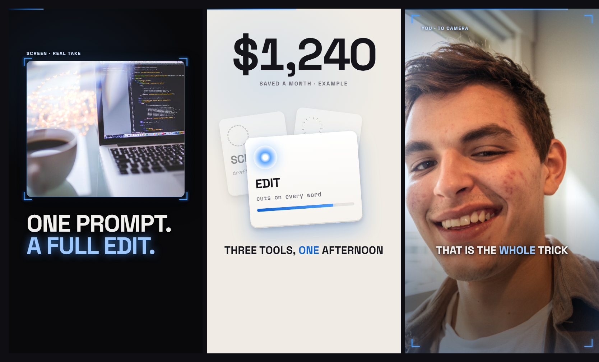

# Style: CAMERA

A motion-first style built around one trademark: a **viewfinder**. Every clip, screenshot and
framed graphic sits inside the same rounded frame with four glowing corner brackets, like the
screen of a camera. Grounds alternate dark and light, scenes change by sliding a new ground over
the old one, and the first ten seconds are almost all movement.

**How to build it:** say "build reel N in the camera style" (the `reel-build` skill). Claude
builds every scene in ravyn from regular clips (your footage, images, text, shapes, keyframes,
captions) following this spec, so you still open it in ravyn, leave notes on the frame and render
from there. ravyn's one-click preset is only the facecam window; everything else here is clips.

**Format:** vertical reel, 1080 x 1920, 30 fps.
**You need:** a voiceover, and real footage of the thing you are talking about (screen
recordings, product clips, you to camera). Stills only when nothing moving exists.

## The five laws

1. **Video over images, always.** For every beat, in this order: real video of the actual
   thing, then a graphic you built for it, then (rarely) a still image. If a clip of the thing
   exists, use the clip. Never describe in text what you could show.
2. **The first 10 seconds carry the whole reel.** A new visual state every 1 to 2 seconds. The
   eye is always tracking something entering, moving, brightening or dimming. About 90% motion
   graphics and 10% text: at most one short line of text in the opening.
3. **Never two texts saying the same thing.** If a big keyword is on screen, mute the caption
   for that beat. Or drop the keyword and let the caption ride alone. Keep both only when the
   keyword adds something new (a stat, a source, a consequence). When a graphic is the hero,
   the graphic wins and text gets out of the way.
4. **No empty frames.** A frame holding only a caption is a swipe. If text must carry a beat
   alone, it performs: enters large, settles, drifts. Never sits still.
5. **Elements never touch.** At least 24 px of clear space between any two elements.

## The viewfinder (the signature)

Every clip, screenshot and framed graphic goes inside it. The shape never changes, only the colour.

| Part | Value |
|---|---|
| Frame | rounded rectangle, radius 28 px |
| Hairline | 2 px inner line, accent colour at 40% opacity |
| Corner brackets | four L shapes, 46 px arms, 5 px stroke, full accent, sitting 16 px outside the corners |
| Bracket glow | `0 0 14px` accent at 75% |
| Float | `0 40px 100px rgba(0,0,0,.72)` plus `0 0 60px` accent at 15% |
| Tag (optional) | small label 58 px above the top-left corner, 25 px, letter spacing 0.16em, `#CFE4FF` |

**Full-bleed mode:** when footage fills the whole screen (you to camera, a big screen recording),
the brackets ride the screen corners instead, 52 px in from every edge.

Recolour the whole reel by changing one accent value. The brackets are what make every reel
recognisably yours.

## Scene types

| Type | What is on screen | Text |
|---|---|---|
| **FRAMED** | one clip or screenshot in the viewfinder, keyword clear of it | keyword or caption, never both saying the same thing |
| **FULL-BLEED** | footage fills the frame, brackets on the screen corners | caption only |
| **HERO GRAPHIC** | a detailed built graphic owns the screen | captions off |
| **KEYWORD** | big type owns the screen, but it moves | captions off |

**Every reel uses dark AND light grounds.** Alternate them across scenes. This is not optional.

## Motion

**Scene change: the ground slides on top.** On a cut, a new opaque ground slides in from one edge
(left, right, top or bottom) and covers the outgoing scene, which does not move or fade. The slide
takes 0.52 s, ease `power2.inOut`, with motion blur (about 14 px) while it travels. Only once it
has landed do the new scene's elements appear on it. Two grounds never cross-fade. Run each scene
about 0.42 s past its cut so the old one is still there while the new ground covers it.

**Big things never leave before small ones.** Footage never vanishes while its frame is still
there, and the frame never vanishes while a graphic inside it is still moving. The ground slide
clears everything at once. If a clip truly must end early, promote what is left: scale it up,
move it to centre, give it a slow glow shift so it becomes the subject.

**Framed media in:** clip and frame scale from 1.10 to 1.00 together, 0.42 s, `power3.out`. Then
the four brackets pop from scale 0.4 to 1, 0.30 s, `back.out(2)`, 0.05 s apart, starting 0.10 s
in. The tag slides in from 24 px left, 0.28 s, starting 0.22 s in.

**Brackets breathe:** while on screen, the brackets swell to 1.12 and back, 1.5 s each way,
`sine.inOut`, 0.09 s apart.

**Keyword in:** from 88 px lower and 0.9 scale to rest, 0.42 s, `power3.out`.

**Sequential items** (a list arriving one by one): each new item enters bright and forward, the
previous one dims to 42% opacity and 0.9 scale over 0.42 s, and they stack so nothing is fully
hidden. Never a static row of equal boxes. Lean stacked cards slightly: -8, +7, -4 degrees.

**Numbers count, they never appear.** Step through about 16 values with a soft click under it.

**Building a graphic that looks like an object:**

1. Build it in code, never paste a stock animation.
2. Give it physical shadows: a bright inset line on the top edge, a dark inset line on the
   bottom edge, and a cast shadow underneath.
3. Anything that lights up gets a lens layer that fills the shape completely (inset 0, same
   radius). Put the outer bloom on the parent, for example
   `box-shadow: 0 0 44px <colour>, inset 0 -5px 0 rgba(0,0,0,.16)`.
4. Stagger state changes 40 to 60 ms apart. Sequence reads as choreography.
5. Light spills through an animated box-shadow, not just a colour swap.
6. Sync every state change to its spoken word.
7. Give it a slow idle drift, about 3% scale over 2 s, so nothing is fully static.
8. Animate only transforms and colours, never layout. That keeps it smooth.

**Make graphics detailed, not diagrams.** A box with some coloured bars is a placeholder. The
test: could someone with the sound off understand the sentence from the graphic alone? Draw the
thing by its real parts, real labels and real state.

**Let the visuals perform the payoff.** On the payoff word, shake the elements, swell them, pull
them to centre. Do not stamp a summary label on top.

**Accents:** a quick punch (scale 1.05 for 0.1 s and back) on a hit word, and an edge glow
(inset 220 px of accent at about 44%, up in 0.12 s, down in 0.45 s) on a big moment.

## Look

| Token | Value | Use |
|---|---|---|
| Dark ground | `#08080A` + accent glow, ellipse 940 x 820 at 32% 20%, 11% | dark scenes |
| Light ground | `#F0ECE5` + the same glow at 15% | light scenes |
| Ink on dark | `#F2F0EE` | text on dark |
| Ink on light | `#15141A` | text on light |
| Accent | `#4C9DFF` (pick your own) | brackets, hairline, emphasis |
| Accent lifted | `#9CC8FF` | emphasis on dark grounds |
| Accent deep | `#1160D2` | emphasis on light grounds |
| Warning | `#FFB020` amber | caution states |
| Good | `#2FD37A` green | success states |
| Bad | `#FF4D4D` red | failure states |
| Muted | `#8A8892` | small labels |
| Font | Space Grotesk 700 | everything: keywords, numbers, labels, captions |
| Code font | a monospace | only when you literally show code or a terminal |
| Grain | noise at 5%, overlay blend | over everything |
| Progress bar | 5 px at the very top, accent gradient | fills across the reel |

**One font.** Vary size and colour, never the family. Mixing in a serif or a second sans is what
makes this look generic.

**No boxes around text or icons.** No filled badge with text in it, no tile or circle behind an
icon. Put a state on the object instead (shake it, flood it red, pulse its edge). For an icon, let
light do the work: a glowing core, a dashed ring, a tick dial, two thin glowing rules. Rings can
also show progress ("3 of 5") without a word.

**A stamp** (a verdict like "sold out") has no background: bright colour, a soft glow
(`0 0 44px` of its colour at about 60%), and an optional thin rule under it.

## Captions and type

- Space Grotesk 700, 60 px, uppercase, letter spacing 0.008em, centred, max 900 px wide.
- **No plate behind captions.** Just text with a heavy shadow:
  `0 4px 30px rgba(0,0,0,.98), 0 2px 8px rgba(0,0,0,.95)`. On light grounds use the light ink and
  a soft white shadow instead.
- The caption band sits at y 1240 to 1450.
- One emphasis word per caption, in the accent colour.
- Keywords: Space Grotesk 700, letter spacing -0.02em, line height 0.94, set large. The payload
  word goes in the accent with a `0 0 42px` accent glow.
- No line on screen for less than about 0.8 s. If it cannot hold a second, cut it.
- Mute any caption that overlaps a keyword or hero-graphic moment at all, not only ones that
  start inside it.

## Sound

- Transitions get soft sounds: a slide, an air puff, a paper swipe. Rotate three of them so no
  two cuts in a row sound the same.
- Pick soft sounds: energy above 5 kHz should sit at least about 40 dB under the overall level.
  A harsh whoosh measures around 11 dB and reads as cheap. No whooshes at all.
- A light pop for element arrivals, a soft key click under counting numbers.
- Every entrance in the first 10 seconds gets its own sound.
- A music bed under the intro: ducked well under the voice, high-passed at about 130 Hz so it does
  not muddy your voice, faded out as the content starts.

## Safe zone

Nothing important below **y 1700**. The app buttons and caption cover it. Keep captions, keywords
and faces above it.

## Checklist before you render

- [ ] Every clip and screenshot sits in the viewfinder (or full-bleed with corner brackets)
- [ ] Dark and light grounds both appear
- [ ] Every scene change is a ground sliding on top, never a cross-fade
- [ ] A new visual every 1 to 2 seconds through the first 10 seconds
- [ ] No keyword and caption saying the same thing at once
- [ ] Every clip runs to the last frame of its scene (no empty tail)
- [ ] No filled box behind any text or icon
- [ ] One font only, plus a monospace only for real code
- [ ] At least 24 px between any two elements
- [ ] Nothing important below y 1700
