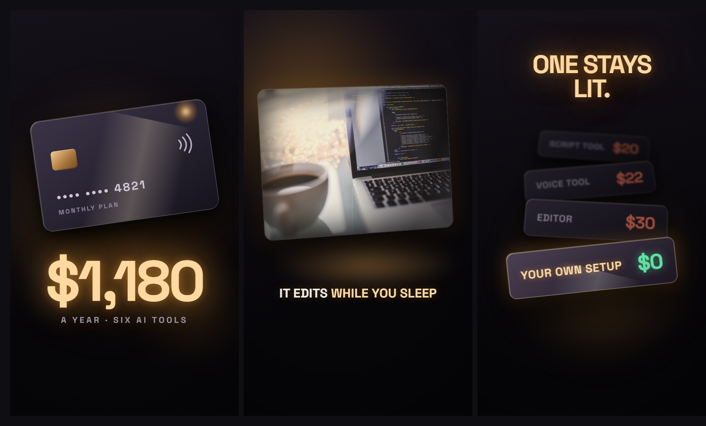

# Style: CINEMA

A cinematic macro style. Everything on screen is a **physical object lit by one warm key light**:
a card on a table, a plate of glass, a gauge with a lit needle. Nothing looks like a web app
panel. Shallow depth of field, warm haze, long soft shadows, and a highlight that sweeps across
every hero object. It looks like a product film, not a screen recording.

**How to build it:** say "build reel N in the cinema style" (the `reel-build` skill). Claude
builds every scene in ravyn from regular clips (your footage, images, text, shapes, keyframes,
captions) following this spec, so you still open it in ravyn, leave notes on the frame and render
from there. ravyn's one-click preset is only the facecam window; everything else here is clips.

**Format:** vertical reel, 1080 x 1920, 30 fps.
**You need:** a voiceover, and a list of the objects your story is about (a card, a laptop, a
price, a tool). Real footage works too, placed in a soft lit frame.

## The one rule

**Everything on screen is a physical object, lit by a single warm key light.**

Not a panel, not a card UI, not a container. An object sitting in a space, catching light on one
edge and falling into shadow on the other. If something on screen could exist as a UI element in a
web app, redraw it as a thing.

## The five laws

1. **One warm key light, and it comes from somewhere.** Every scene has a light with a position,
   usually just off frame. Everything is lit from it: a warm bloom off frame, objects rim-lit on
   the side facing it, shadows falling away from it. Never flat, even light.
2. **Depth of field is real.** The foreground is sharp. The background falls off into a soft warm
   haze, with blurred glow pools behind objects. Nothing is evenly in focus.
3. **Objects tilt, they do not sit square.** Slight rotation, slight perspective. A card at
   -8 degrees reads as a thing on a table. The same card at 0 degrees reads as a box on a web page.
4. **Light moves across surfaces.** A highlight sweeping over an object is the signature move of
   this style. Every hero object gets one when it enters.
5. **Type glows because it is lit, not because it has a shadow.** Warm off-white and amber, with a
   soft outer glow that matches the key light. Set it large. Never on a plate, never in a box,
   never with a hard drop shadow.

## Turning things into objects

Before you build a scene, name its object. Then light it.

| Instead of | Build |
|---|---|
| a row in a filled box | a lit plate, tilted, with a long shadow |
| a list of cards | objects stacked in depth, nearer ones sharper, farther ones blurred and darker |
| a meter with a fill bar | a physical gauge with a lit needle and a glass highlight |
| a hard frame around footage | a soft-edged lit frame, a vignette, warm light spilling onto the ground under it |
| a coloured badge | nothing. Put the state on the object with light and colour |
| a caption | unchanged: lit type, no plate |

**Example beats** for a reel about what your AI tools cost:

| Beat | The object, lit |
|---|---|
| Hook | a payment card, tilted, highlight sweeping, warm bloom behind; each charge lands as a light pulse |
| Proof | paper cuttings on a warm ground, curling, lit from one side |
| The spike | a pile of charges lifting and scattering out of the light |
| Unlimited | a gauge, lit needle sweeping past its stop |
| The catch | four plates in depth, three falling dark, one staying lit |
| The machine | a laptop as a real object, its screen glow spilling onto the desk |
| Demo | footage in a soft lit frame with warm spill |
| The ledger | two columns of lit plates: paid ones cooling, free ones warming |
| The honest bit | two thin light rules, and nothing else in frame |
| Call to action | a comment field as a lit object, the caret glowing |

## Motion

- **The sweep:** a soft white band (about 50% of the object's width, 20% opacity, rotated
  20 degrees) travels across the object on entry. One per hero object.
- **Light pulses, not pops.** A state change is the light changing: an object warming, cooling,
  falling dark, catching the key.
- **Depth moves:** things arrive from the haze into focus (blur to sharp) and leave by falling
  back into it (sharp to blurred and darker).
- **Never frozen.** Keep a slow drift on every scene so nothing sits dead still.
- **No flat moves.** No slide-in panels, no bouncing text, no preset transitions.
- **The first 10 seconds are about 90% motion and 10% text.** At most one short text element in
  the opening. The objects carry it.
- **Graphics must be detailed enough to read with the sound off.** A plain shape with bars in it
  is a placeholder. Draw the real parts.

## Look

| Token | Value | Use |
|---|---|---|
| Ground | `linear-gradient(165deg, #141018, #050407 70%)` | every dark scene, never flat black |
| Key light | `rgba(255,170,60,.30)` radial, blurred 30 px or more | the warm bloom |
| Lit | `#FFD9A0` | type the key light is hitting |
| Warm muted | `#9A93A6` | captions and small labels, still warm |
| Money | `#FFB84D` | numbers |
| Paid | `#FF7A5C` warm red | a cost, never an alarm |
| Free | `#5FE0A0` warm green | savings, the good option |
| Surface | `linear-gradient(150deg, #3A3346, #15121C)` | any physical object |
| Shadow | `0 30px 60px rgba(0,0,0,.85)` | always long and soft |
| Edge | `1px solid rgba(255,255,255,.15)` | a lit edge, not a border |
| Font | Space Grotesk 700 | everything, one family |

**Measuring note:** the shadow, edge and blur values above were set on a small 340 px wide board.
At full 1080 px width, scale them up about 3x (for example a 90 px blur bloom, a 3 px edge, a
`0 90px 180px` shadow). Colours stay the same.

**Light grounds:** every reel mixes dark and light scenes. In this style the light ground is a
warm paper, never a cold white.

**Marks and logos** keep their own colour. On a dark ground, give a mark one soft halo in its own
colour. Never a white core glow around it, which reads as an outline. On a light ground, darken
the hue instead of glowing: a glow on paper turns to mud.

**No containers.** Never a filled shape behind an icon. Let light, material or an open frame do
the work.

## Captions and type

- Space Grotesk 700, about 60 px, uppercase, centred. One font family for everything.
- No plate behind captions. Lit type with a soft warm glow and a soft dark shadow, never a hard
  drop shadow.
- Captions and labels in Warm muted `#9A93A6`, or warm off-white when they need to read over
  footage. The one word that matters goes in Lit `#FFD9A0`.
- Big numbers: Lit `#FFD9A0` or Money `#FFB84D`, set huge (around 270 px for a hero number),
  letter spacing -0.04em, glow `0 0 50px rgba(255,170,60,.6)` (scale that up at full size).
- Small labels under a number: wide letter spacing, 0.24em.

## Sound

- Soft and warm. Low whooshes and harsh highs break the film feel.
- Give light its own sound: a low soft swell when the key light moves or an object lights up, a
  muted tick when a plate falls dark.
- A warm music bed under the voice, kept well below it.

## Safe zone

Nothing important below **y 1700**. The app buttons and caption cover it. Keep numbers, captions
and the hero object above it.

## Checklist before you render

- [ ] Every scene has one key light with a clear direction, and everything is lit from it
- [ ] Nothing on screen could pass for a web app panel
- [ ] Every hero object is tilted and gets a highlight sweep on entry
- [ ] Background falls into soft warm blur; foreground is sharp
- [ ] Ground is the warm gradient, never flat black
- [ ] Type glows warm, never sits on a plate or in a box
- [ ] One font family only
- [ ] Dark and light (warm paper) scenes both appear
- [ ] Every clip runs to the last frame of its scene
- [ ] Nothing important below y 1700
