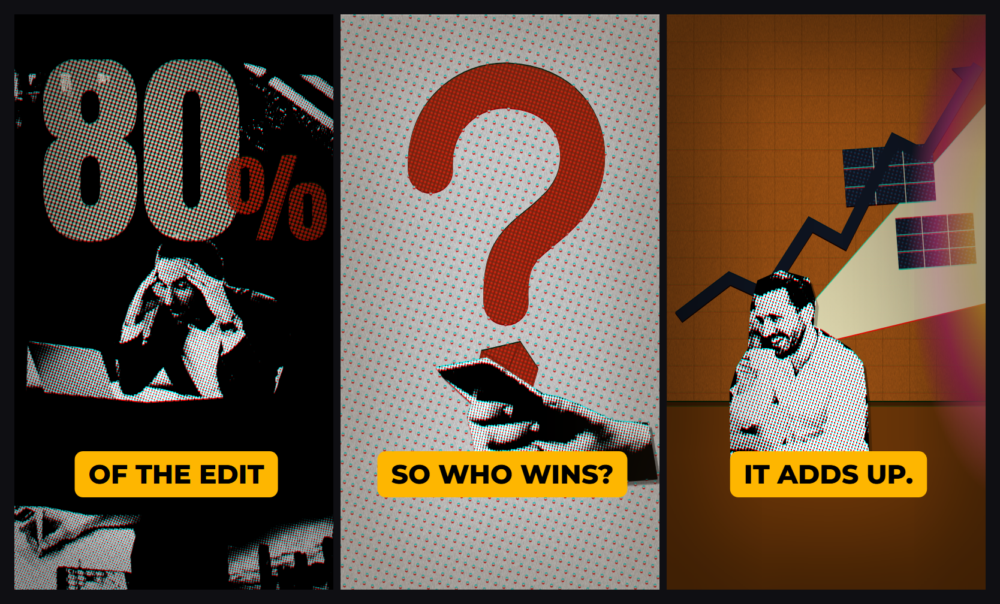

# Style: COLLAGE

A faceless reel that looks like a printed zine come to life. Every scene is a small paper
**diorama**: black-and-white halftone photo cutouts, a coloured paper wall, and one giant
hand-drawn shape. A camera that never stops moves through it, light leaks and falling cards
carry you to the next set, and one yellow caption pill holds still while the world moves.

**Format:** vertical reel, 1080 x 1920, 30 fps. No talking head.
**You need:** a voiceover, a handful of photos of the real objects in your story (people, a
product, a page, a screen), and some time to cut them out. The work is in making the paper
world, not in animating it. Build it in ravyn.

## What a scene is made of

Every scene is a set, not a slide. Build each one from the same four parts:

| Part | What it is |
|---|---|
| **Ground** | Pure black stage, or a coloured paper wall (one colour per scene) |
| **Subject** | One cutout photo: a person, a product, an object. Black and white, halftoned |
| **Props** | One or two more cutouts, or torn photo strips at the frame edges |
| **Giant shape** | One big hand-drawn graphic: a question mark, a number, a chart line, a cube |

**Laws:**

1. Text is never the subject. The caption pill is the only text you add. Anything else that
   reads as text must be printed on a real object (a newspaper headline, a label, a box).
2. No icons, no UI mockups, no charts drawn as charts. A chart line is a paper cutout.
3. One ground per scene, and change it often: about six grounds in a 40 second reel, never the
   same one twice in a row (except the closing bookend).
4. Something new lands about every **0.9 s**.

## The scene types you will use

- **HOOK:** subject cutout on black, camera pulling back, a mega number counting up.
- **QUESTION:** a giant red hand-drawn "?" grows behind the subject, photo strips fly in from
  the edges. Then the shape becomes an object: the dot swells into a crumpled red cube.
- **WHITE FLIP:** the ground wipes from black to white dotted paper, objects drop onto it.
- **DESK:** a coloured paper wall, a subject at a desk, a light beam that reveals something
  (a data grid, a page), a paper chart line rising.
- **PRINT:** a sepia newspaper page, slow drift, a red marker painting behind the headline on
  the words you say.
- **OBJECT:** one real object tumbling on pure black. Nothing else.
- **BOOKEND:** the opening image again, so the loop reads as one continuous thought.

## The print treatment (always on, applied once to the whole stage)

This is what makes photos, paper and shapes look like one printed page. Never treat elements
differently from each other.

| Layer | Value |
|---|---|
| Halftone, coarse | **29.5 px** dot pitch at **20 degrees**, on the paper grounds |
| Halftone, fine | **6.3 px** dot pitch at **18 degrees**, inside every photo and graphic |
| Colour split | red channel shifted **4 px** (mostly vertical). Red fringe on one side, cyan on the other, on every hard edge |
| Vignette | corners about **40%** darker, soft and warm (`inset 0 0 320px 140px` at 45% black) |
| Grain | none as a layer. Texture lives in the assets: paper fibre, torn edges |
| Photos | black and white, contrast pushed hard (levels about 25% to 85%), cut out with torn or straight edges |

How to get it: cut the photo out, make it greyscale, push the contrast, multiply a dot pattern
over it and threshold. Do the 4 px red shift once, on the whole stage, so everything matches.

## Motion

### The camera never stops

Every scene has a camera move. Static frame time is zero.

- **Hook pull-back:** from 1.0 to about **0.5** scale in **2.4 s**, fast then slowing
  (power2 out), anchored on the subject's head.
- **Everywhere else:** slow pushes or pulls, linear, about 1.00 to 1.06 over the scene. Moves
  read smaller on a phone than you think, so do not be shy.
- **Tilt:** the camera tilts down to leave one set and find the next, about **1 s**.

### Entrances

Nothing pops in from nothing. Everything arrives from an edge, grows from a point, or is
revealed by light.

| Element | Move | Time |
|---|---|---|
| Object landing (a logo, a bag) | drops from above, small overshoot | 0.25 s |
| Mega number | slides in from the left while it counts up | 0.5 s |
| Mega number exit | straight up, out of frame | 0.2 s |
| Giant shape ("?") | grows from the bottom up, behind the subject | 0.4 s |
| Photo strips | fly in from the four edges, staggered | 0.3 to 0.4 s each |
| Shape to object morph | hook squashes away, dot swells into a cube | 0.5 s |
| Light beam | grows outward from its source | 0.5 s |
| Panels inside the beam | pop in | 0.15 s each |
| Paper chart line | rises from bottom left across the frame | 0.8 s |
| Red marker | wipes left to right behind each headline line | 0.4 s per line |
| Object exit | drops out the bottom with a slight rotation | 0.5 s |

### Transitions: leave every scene with a physical event

Use at least four different kinds per reel. Never a crossfade, never a dip to black.

| Transition | Anatomy |
|---|---|
| **Light leak** | one magenta flare frame, then an orange burn growing to a full white-out, then the next scene fades up from overexposed. 0.5 to 0.9 s |
| **Card fall** | the whole scene is one flat card: it tilts back (top away, about -28 degrees), blurs to about 20 px and slides down and out. The next scene waits underneath, blurred, and sharpens as the card leaves. Slow and heavy: about 1.5 s |
| **Ground wipe** | the new ground wipes in top to bottom with a hard edge, 0.2 s. Objects stay |
| **Camera tilt** | one continuous move: the old set leaves the top, the new one rises from below, 1 s |
| **Rack focus** | the next scene goes from blur 18 px to sharp, 0.5 s |
| **Hard cut** | once, on a whoosh, for the biggest change |

## Look

| Token | Value | Use |
|---|---|---|
| Stage black | `#000000` | hook, object and bookend scenes. Pure, no grain |
| Caption pill | `#FEB600` | the only colour that stays across every scene |
| Caption ink | `#000000` | pill text |
| White paper | `#F8F8F8` + coarse dots | the white flip |
| Burnt-orange wall | `#B86018` | desk scenes |
| Khaki wall | `#402800` | moody sets |
| Newsprint | `#D8A880` sepia | print scenes |
| Navy | `#0E1420`, gridlines `#F4EEC2` cream | data grids, chart lines |
| Signal red | `#902410` core, `#B52309` dots | the giant shape, the cube |
| Marker red | `#C8341A` | painting behind a headline |
| Number cream | dots `#D8C8B0` on black | the mega number |

One warm ground per scene, one signal red, one product colour from your story, one caption
yellow. Almost no blue except the navy.

| Role | Font | Size |
|---|---|---|
| Caption pill | Montserrat 800, ALL CAPS | 88 px (cap height 62 px) |
| Mega number | Anton | digits about **600 px** tall, cream halftone, the % at half height in dark red |

## Captions: the pill is a fixture

- One yellow pill, **154 px** tall, top at **y 1458**, centre **y 1534**, centred left to right.
- Padding **46 px** each side, corner radius **28 px**, no shadow.
- Width fits the text. Group words by their **measured width, never by word count**: the pill
  must stay under **980 px** wide, which leaves 50 px clear at each edge. In Montserrat that is
  usually 1 to 3 short words. A condensed bold sans fits more (about 38 to 40 px per character).
- **Hard cut** to the next chunk, landing about 0.03 s after the word starts. Never animate
  the pill. The world moves, the pill does not.
- Break at phrase boundaries and keep the punctuation: `SO WHO WINS?` / `IT ADDS UP.`
- Expect a new pill about every **0.6 s**.

## Sound

- Voice: loud, close, dry, about **195 words a minute**.
- **No music.** The bed is a **37 Hz** sub drone with a little rumble on top, about **6 dB
  under the voice**. Loudest in the first act, then lower, swelling under the transitions.
- **One sound per visual change:** a whoosh for things entering and leaving, a thud for things
  landing, a sub hit for morphs and tumbles, a tick for each marker line.
- The biggest light leak gets the loudest hit of the reel.
- End on an open word and a rising whoosh, on the same image you opened with. The viewer's
  brain rewinds, and the loop feels seamless.

## Safe zone

Nothing important below **y 1700**. The app's buttons and caption sit there. The pill bottom is
at y 1612, so it is safe. Torn photo strips and paper clutter can run to the bottom edge; they
are decoration, not information.

## Checklist before you render

- [ ] Every scene is a diorama: ground, subject cutout, props, one giant shape
- [ ] The print treatment is on everything: halftone, 4 px red split, vignette
- [ ] Every scene has a camera move, nothing sits still
- [ ] Every transition is a physical event, at least four kinds, no crossfades
- [ ] The only added text is the yellow pill, never wider than 980 px
- [ ] Every visual change has a sound, the sub drone sits under the voice
- [ ] The reel opens and closes on the same image
- [ ] Nothing important below y 1700
