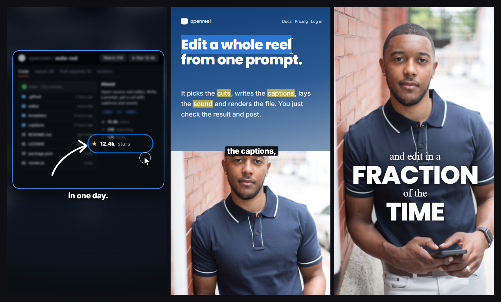

# Style: CURSOR

A talking-head reel where every claim gets a **receipt**: the real page, app or terminal on
screen, with a cursor that moves, clicks, selects and copies. You are the anchor, the screen is
the proof, and the cursor is the presenter. Text speaks in two voices: a small serif whisper and
a big sans shout, stacked on the word you say.

**Format:** vertical reel, 1080 x 1920, 30 fps. Fast: about one new scene every 1.8 seconds.
**You need:** a talking-head video of yourself, screen recordings of the real thing you are
talking about (with the mouse visible, or a scripted cursor added on top), and a few logos,
photos or numbers. Build it in ravyn.

## The scene types

| Type | What is on screen | Text |
|---|---|---|
| **RECEIPT CARD** | The real page in a rounded, outlined card, over a blurred copy of the same page | Caption box, 1 to 3 words |
| **SPLIT** | Page on the top half, your face on the bottom half, seam at y 960 | Caption box sitting on the seam |
| **FACE PUNCH** | Your face, full frame | A two-voice text stack on your chest, or the caption box |
| **WHITE BOARD** | Plain white ground: logos popping in, a simple flow diagram, a dropdown | Caption box in grey |
| **FOOTAGE / PHOTO** | A real photo or short clip, full frame, slowly pushing in | A shout word slams in, or the caption box |

Rough budget for a reel: screen receipts about **50%** of the runtime, your face about **23%**,
built graphics (logos, diagram, text stacks) about **27%**.

**Sequence rules:**

1. Open on a SPLIT or your face, so a real person is there in the first second.
2. Nothing is described that could be shown. If you say it, show the page that proves it.
3. The same page can come back two or three times. That is fine, it builds trust.
4. Use the SPLIT when you list things: highlight each item ON the page as you say it.
5. Close on a FACE PUNCH with the call to action as a text stack.

## Layout

### Receipt card

- Card: **91% of the frame width** (983 px wide, x 48), corner radius **42 px**.
- Outline: **4.5 px** in the subject's blue (default `#449cff`).
- Behind the card: the same recording, scaled up to fill the frame, blurred **30 px** and
  darkened about **40%**.
- The card pushes in slowly, about **2% per second**, the whole time it is on screen.

### Split

- Two equal halves. Page on top (0 to 960), face on the bottom (960 to 1920).
- Crop the page tight, so the words you are about to say are big enough to read.
- Your face: eyes about one third down from the seam.

### Two-voice text stack (over your face or footage)

- Centred, sitting on your chest. Never over your mouth.
- Lines alternate: serif, SANS, serif, SANS. Example: `and edit in a` / `FRACTION` / `of the` / `TIME`.
- The serif carries the small connecting words. The sans carries the noun or the payoff.
- The two voices never share a line. Each line lands on the word it shows.
- Lines build up and stay until the whole stack is replaced.

## The cursor devices (the signature)

Every screen scene has the cursor moving. It never rests. A still screenshot is the failure.

| Device | How it works | Timing |
|---|---|---|
| **Idle drift** | Small, human movement, 1 to 3 px per frame, faster on purpose moves | always |
| **Click ring** | Thin grey circle, 2 px border, grows about 60 px and fades out | 200 ms |
| **Drag-select** | The browser's blue selection paints across the headline, word by word | about 600 ms |
| **Copy to Copied** | Cursor clicks the copy button, the label flips to "Copied" | instant swap |
| **Dropdown scroll** | Cursor opens a menu and scrolls the list | 1 s |

If your recording has no cursor, add one on top: an arrow cursor moving on a path, a click ring,
a growing rectangle for the selection, and a small chip that swaps its text.

## Pointing devices

How you aim attention. Never assume the viewer finds the right spot by themselves.

- **Blur-refocus:** the whole card blurs to **18 px** while the one row that matters stays
  sharp and scales **1.0 to 1.4**, both in **200 ms**. A **7.5 px** pill ring draws around it
  in 200 ms (`#0071dd`). Hold about **1.7 s**.
- **Drawn outline:** a pill outline draws itself around a word or button, clockwise, **300 ms**.
- **Drawn arrow:** a white hand-drawn arrow draws from tail to head, **300 ms**, right after
  the outline.
- **Highlighter:** a translucent yellow box appears on each word ON the page, in one frame, at
  the moment you say it (`#bcab67` at about 55% over a blue page).
- **Marker sweep:** a solid `#e7bd18` box wipes left to right over a word in **200 ms**, and
  the covered text turns blue `#0029ec`.

## Motion

| Move | Numbers |
|---|---|
| Face punch (every cut to your face) | scale **1.3 to 1.0** with blur **8 px to 0**, over **300 ms** |
| Face between takes | small jump cuts every 1 to 2 s, reframe about 5%, slow zoom about 1% per second |
| Sans shout slam | arrives from scale **1.4** with a 12 px directional blur, settles in under **100 ms**, linear, hard |
| Serif whisper | fades in with a tiny scale, 0.95 to 1.0, **150 ms** |
| Badge or label pop | scale 0.7 to 1.0, 200 ms |
| Logo grid pop | scale 0.6 to 1.0, 150 ms, one logo per spoken word |
| Logo slide-reveal | big logo mark shrinks 1.6 to 1.0 and slides about 210 px left, uncovering the wordmark behind it, 500 ms |
| Card whip-in | card enters from the left at 1.15x with horizontal blur, settles in 300 ms |
| Diagram node | lands on its word with a glow ping: 0 to 24 px, 200 ms up, 400 ms down |
| Dotted connectors | draw out from the centre, 300 ms |

**Transitions are hard cuts.** The only soft moves are the face punch and the card whip.
No crossfades, no dip to black, no preset wipes.

## Look

The reel has no colour of its own. It **borrows the subject's colours**: the product's blue,
the code host's dark, the brand's accent. Only the caption box and the white overlay type stay
fixed.

| Token | Value | Use |
|---|---|---|
| Dark ground | `#0b0f13` | behind screen cards |
| Blurred backdrop tint | `#0d1629` | the darkened copy behind a card |
| White ground | `#ffffff` | logos, diagrams, dropdowns |
| Black plate | `#000000` | a docs section, a README |
| Cream card | `#edd9c9` | a drawn illustration beat |
| Warm accent | `#df7c53` | a disc or one coral serif line on the cream card |
| Card outline | `#449cff`, 4.5 px | every receipt card |
| Focus ring | `#0071dd`, 7.5 px | blur-refocus |
| Quote caption | `#2086ff` | only when the words are a literal quote from the page |
| Highlighter | `#bcab67` at 55% | words on a page |
| Marker | `#e7bd18`, text turns `#0029ec` | a sweep on a word |
| Diagram node | outline `#396dff`, fill `#eaf1ff`, 1.5 px, radius 12 px | flow diagram |
| Caption box on dark | `#0a0b10` at 92% | most scenes |
| Caption box on white | `#5e5e5e` solid | white grounds |

| Role | Font | Size |
|---|---|---|
| Caption box | Inter 800 | 51 px, box 63 px tall, radius 9 px |
| Sans shout | a geometric sans (Poppins 800) | 120 px to 400 px, tracking about -2%, caps for the payoff word |
| Serif whisper | a classic serif (DM Serif Display) | 66 px to 96 px, always lowercase |
| Quote caption | the geometric sans, medium | about 72 px, real curly quotes |
| Diagram labels | Inter | 18 to 21 px caps, tracking +5% |

## Captions

- One tiny box, **1 to 3 words**, white bold text. It hard-cuts to the next chunk on the first
  word of that chunk. It never grows, never changes colour, never animates.
- Position: centre **y 1258** (65.5% of the height) on full-frame scenes, **y 960** (on the
  seam) on SPLIT scenes.
- Break chunks where the phrase breaks: `12.4k stars` / `in one day.` Keep the punctuation.
- When the words are a literal quote from the page, drop the box and use the blue quote style.
- On a text-stack scene, the stack IS the caption. No box.
- Numbers as digits on screen, even when you say them as words.

## Sound

- **No music.** Your voice carries the reel, fast, about 220 words a minute, dry and close.
- **First 40% of the reel:** a short sub-bass drop on each cut.
- **From the turn to the end:** a single low drone around **35 Hz**, about **6 dB under your
  voice**, fading over the last **1.5 s**. Felt more than heard. It is the tension.
- A **whoosh** on every cut and every slam. A soft **tick** on every highlight, caption change
  and diagram node. About one sound per visual event, never on every word.
- Face scenes: only the punch whoosh. Let the room tone breathe.

## Safe zone

Nothing important below **y 1700**. The app's buttons and caption sit there. The caption box
at y 1258 and the text stacks on your chest are well above it. If you add your handle, put it
at the top (about y 96), never at the bottom.

## Checklist before you render

- [ ] Every claim has a receipt on screen: the real page, app or terminal
- [ ] The cursor moves in every screen scene, and it clicks or selects at least once
- [ ] At least one blur-refocus, or one drawn outline with an arrow
- [ ] Every cut to your face is a 1.3 to 1.0 punch
- [ ] Text stacks alternate serif, SANS, serif, SANS, each line on its word
- [ ] Caption box is 1 to 3 words, hard cut, never animated
- [ ] Hard cuts only, no crossfades
- [ ] No music, a whoosh on every cut, the low drone under the second half
- [ ] Nothing important below y 1700
