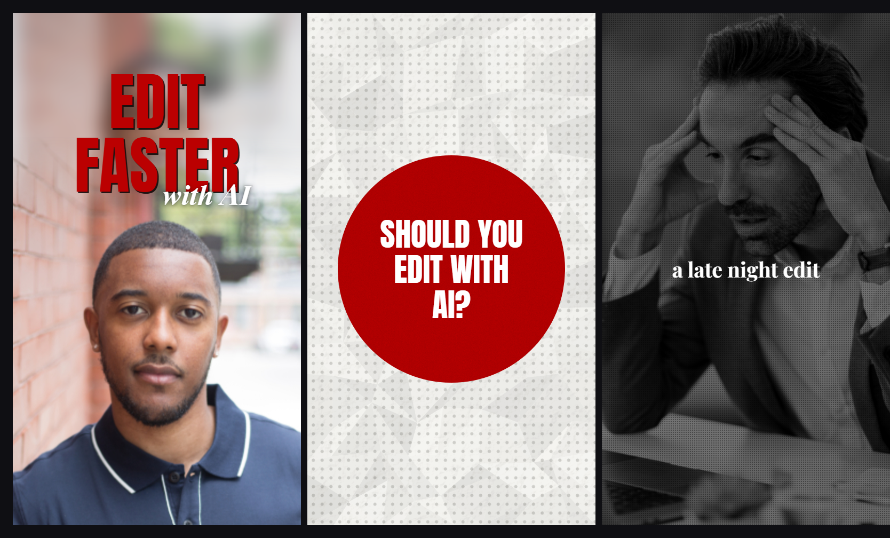

# Style: HEADLINE

A talking-head style that reads like a tabloid front page. Your face stays on screen almost the
whole time, and all the motion lives in the top third, above your head: one serif caption that
swaps every second, big red condensed words that rise up on the word you say them, a soft italic
line under them, and now and then a full-frame paper card or a black and white insert with a
typed label. No music, no sound effects. The rhythm is your voice plus a visible change about
every 0.9 seconds.

**Format:** vertical reel, 1080 x 1920, 30 fps.
**You need:** a talking-head video of yourself (a phone selfie is fine, looking into the lens), a
word-level transcript of it (any transcriber that gives per-word times), a few pieces of plain
footage for the black and white inserts (a cafe, a desk, a city), and any receipts you want to
show (your own spreadsheet, a screenshot, a photo).

**How to build it:** say "build reel N in the headline style" (the `reel-build` skill). Claude
builds every scene in ravyn from regular clips (your footage, images, text, shapes, keyframes,
captions) following this spec, so you still open it in ravyn, leave notes on the frame and render
from there. ravyn's one-click preset is only the facecam window; everything else here is clips.

## The nine rules

1. **Your face never leaves.** About 94% of the runtime is you, with no punch-ins. Long unbroken
   stretches are fine (one minute or more), because the overlays carry the motion, not cuts.
2. **One caption, one spot, hard swaps.** A bold serif, white with a thin black outline, dead
   centre at 32% of the height. It changes on the first word of each phrase. It never moves,
   never lights up word by word, never animates.
3. **Two type voices and one red.** The SHOUT (red condensed caps) for the words that matter, the
   WHISPER (white italic serif) as a soft second line under it. Every emphasis is one of these.
4. **Shout words land on the spoken word, one at a time.** Each one rises through a mask on its
   word, then the whole group disappears in one frame when the phrase ends.
5. **Cards are a separate paper world.** Dotted, crumpled paper with one shape at the exact centre
   of the frame: a red circle, a pink ring, a black diamond. Shapes move; text on them pops.
6. **Receipts are real and they walk.** If you show a spreadsheet, highlight the row you are
   talking about and move the highlight down as you talk.
7. **Categories are black and white, specifics are colour.** Generic footage (a cafe, a gym, a
   skyline) is fully desaturated, darkened, and labelled with a typed serif word. The specific
   thing you are talking about gets full colour.
8. **Nothing drifts, nothing overshoots.** Entries are fast ease-outs or one-frame pops. Holds are
   dead still. Exits are hard cuts. There is exactly one bouncy move in the whole style (stickers).
9. **No designed sound.** No music bed, no sound effects. Your voice carries it.

## Layout

| Zone | y range (1080 x 1920) | What lives there |
|---|---|---|
| Shout and whisper | 222 to 666 | red words, the italic line under them |
| Receipt cards and stickers | 63 to 522 | spreadsheet crops, shape stickers, a small map |
| Caption | centred on y 616 | the one serif caption |
| Your head | about 780 to 1845 | frame yourself low, so the top third is empty wall |

Stack order when everything is on: card or sticker, then the caption, then your face. Nothing ever
covers your face except the full-frame paper cards and inserts.

## Scene types

| Type | Share of runtime | What is on screen |
|---|---|---|
| **FACE + CAPTION** | most of it | you, the serif caption, sometimes a receipt card above it |
| **SHOUT LOCKUP** | a burst every 30 to 80 s | 1 to 4 red words above your head, optional italic whisper, no caption |
| **PAPER CARD** | 1 to 3 s each, a few per reel | full frame dotted paper with one centred shape |
| **B&W INSERT** | about 3% | full frame black and white footage with a typed label at dead centre |
| **COLOUR BURST** | under 1.5 s | three full-colour photos, 12 frames each, hard cuts |

The opening 5 seconds usually stacks the best devices: a 3-frame cover lockup, a shout word with
its whisper, a red circle card, a ring card, then back to your face for the first caption at
about 6 s.

## The devices, measured

**Shout words.** Anton, all caps, red `#BB0001`, a hard dark shadow offset about 4.5 px down-right.
Cap height 180 to 205 px, up to 832 px wide (77% of the frame), centred. One or two words per
line, stacked with about 32 px between lines.

**Whisper.** Playfair Display Italic, about 105 px, white, a soft dark shadow. It tucks under the
right end of the last shout word, overlapping it a little.

**Red circle card.** A red disc 852 px across at the exact centre (540, 960), with a light grain.
White Anton caps inside, 3 lines, cap height about 95 px, line pitch 132 px, block about 628 px
wide.

**Ring card.** A white crumpled disc inside a pink `#EBC1C0` ring, outer diameter 1340 px (wider
than the frame, so the sides clip), rim 82 px. Inside: one red script word (Playfair Display Black
Italic, about 180 px) over one red oblique Anton word (cap about 105 px).

**Badge card.** A black `#12120F` rounded diamond 665 px across at the centre, with a thin white
inset outline, a number in a bold grotesque (cap about 69 px) over a small unit line.

**B&W insert.** Saturation 0, darkened so the frame sits around 17% to 30% brightness (a skyline can
be lighter). A fine dot texture over the footage. The label is a bold serif, lowercase, white, about
75 px, at dead centre, no outline.

**Receipt card.** Your own sheet, cropped to the block you are talking about, 940 px wide (87%),
at y 285 to 522, soft shadow. Header `#1D3662`, the spoken row tinted `#F4C7C3`, input values blue
`#1603CB`, the total row green.

**Small map.** About 520 px wide at y 237 to 554, fill `#EDDFB8`, outline `#8B7A52`, a dark red pin.

**Stickers.** Generic shapes or your own photos (never cutouts of real people you do not have
rights to), about 300 x 385 px, a 9 px white outline, centred near x 554, y 63 to 449.

## Motion (30 fps)

| Move | Used by | Duration | Curve |
|---|---|---|---|
| Rise through a horizontal mask | shout words, the badge | 3 to 11 frames (0.10 to 0.37 s) | ease-out, no overshoot |
| Slide in from off-screen left | red circle, ring card | 9 to 10 frames (0.33 s) | ease-out |
| Exit to the right | red circle | 6 frames (0.20 s) | ease-in, accelerates off |
| Blur-to-sharp, letters left to right | whispers | 7 to 8 frames (0.25 s) | near linear |
| Hard pop | every caption, short shout words, words on cards | 1 frame | none |
| Typewriter | insert labels | 1 to 2 frames per letter, each letter grey to white over 2 frames | linear |
| Ripple | ring card | 18 frames per ripple, one every 0.67 s | ease-in-out |
| Inner disc grow | ring card arrival | 7 frames, rim thins from 198 px to 82 px | ease-out |
| Double circle wipe | badge to a line drawing | reverse mask 4 frames, crumpled white circle grows 7 frames, dotted paper circle grows 4 frames | ease-out |
| Draw-in | map (9 frames), line drawing (6 frames) | progressive | linear |
| Scale-pop | receipt cards | 2 to 3 frames, 85% to 100% | ease-out |
| Unfold + elastic settle | stickers only | scaleY 0 to 1 in 3 frames, then about 0.5 s with 2 small bounces | elastic |

Exact numbers to copy:

- **Shout rise**, top edge per frame for an 11-frame rise: 672, 618, 564, 516, 472, 435, 400, 372,
  348, 333, 321, 318. The mask line sits about 705 px down. Fast at the start, settling, no bounce.
- **Circle slide**, centre x per frame: -30, 125, 249, 345, 417, 470, 503, 525, 534, 540.
- **Exits:** shout groups, stickers, receipts and the map leave with a hard cut in one frame. The
  ring card leaves with a 2 to 3 frame dissolve and a slight upward drift.
- **Idle:** none. Every overlay is dead still while it holds.

**Word sync.** Every event lands within 1 to 4 frames after its word starts, and never more than 1
frame before it. A shout word lands on its own word: two words, two landings.

## Look

| Token | Value | Use |
|---|---|---|
| Red | `#BB0001` | shout words, the circle, script words. The only accent |
| Pink | `#EBC1C0` | ring rim and ripple (red at about 25% over paper) |
| Paper | `#F5F5F2`, creases down to `#DFDDDA` | every card background |
| Dot grid | `#D0D0CC`, 12 px dots, 33 px pitch, square grid | on all paper |
| Black | `#12120F` | the badge diamond |
| White | `#FFFFFF` | captions, whispers, insert labels |
| Shout font | Anton, cap 180 to 205 px | headlines |
| Whisper font | Playfair Display Italic, about 105 px | the soft second line |
| Caption font | Playfair Display Bold, about 60 px | everything you say |
| Label font | Playfair Display Bold, about 75 px, lowercase | B&W insert labels |
| Badge font | Inter 800 | numbers on the badge |

Palette law: one red, black, white and paper. Anything else in colour is a real receipt.
Three font families total (Anton, Playfair Display, Inter). Never a fourth.

## Captions

- Every phrase you say, 2 to 5 words (about 3.5 on average), sentence case with punctuation.
- One line, centred at x 540, y 616. White, about 3 px near-black outline, a soft shadow about
  4.5 px down-right.
- Hard swap on the first word of the phrase. Median hold 0.90 s (shortest 0.20 s, longest 3.70 s).
- No caption on paper cards or B&W inserts (the card or label replaces it), and it drops out while
  a shout lockup is up.

## Sound

- Your voice only. No music, no sound effects, not even on the card moves.
- Talk fast and close: aim for about 219 words a minute, with almost no gaps
  (longest about 1.1 s).
- Loud and limited: peaks near -0.4 dBFS, average about -17 dBFS.
- If you add anything, add it on purpose. Silence under the overlays is part of the look.

## Safe zone

Nothing important below **y 1700**. In this style that is easy: every overlay lives above your
head, between y 63 and y 666. Only your face and shoulders sit low in the frame.

## Checklist before you render

- [ ] Your face is on screen for about 90% of the reel, with no punch-ins
- [ ] One caption style, one position (y 616), hard swaps on the first word of each phrase
- [ ] Shout words are red `#BB0001` Anton, one per spoken word, rising in 0.10 to 0.37 s
- [ ] Nothing overshoots or drifts, except the sticker unfold
- [ ] Every paper card has one shape at the exact centre of the frame
- [ ] B&W inserts are fully desaturated and labelled with a typed lowercase serif word
- [ ] No more than three font families
- [ ] No music and no sound effects
- [ ] Nothing important below y 1700
