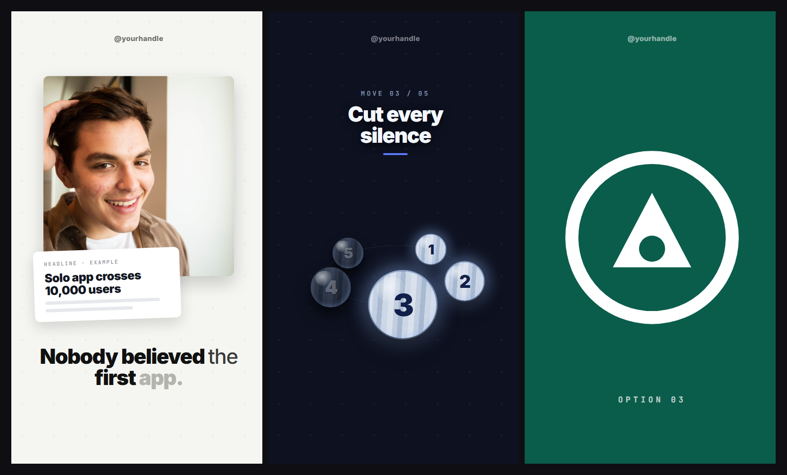

# Style: ORBIT

A style for a story that is really a **system**: "it comes down to 5 moves", "the 5 things that
made it work". One abstract object, a five-body orbit, stays on screen for most of the reel and
lights up one body at a time as the story reveals each part. Around it, the room changes every
beat: a new ground colour, new real evidence. The orbit is the spine, the media is the proof, and
the type never decorates either.



**Format:** vertical reel, 1080 x 1920, 30 fps.
**You need:** a voiceover with word timestamps, a script that promises a number of things (five
works best), and real captures for every claim: articles, screenshots, listings, photos, screen
recordings. A small set of soft sound effects.

**How to build it:** say "build reel N in the orbit style" (the `reel-build` skill). Claude
builds every scene in ravyn from regular clips (your footage, images, text, shapes, keyframes,
captions) following this spec, so you still open it in ravyn, leave notes on the frame and render
from there. ravyn's one-click preset is only the facecam window; everything else here is clips.

## Why it works

- **The orbit makes the promise visible.** The moment a script says "5 moves", the viewer starts
  counting. Four dark bodies and one lit is a progress bar that does not look like one, and it
  keeps people watching: they can see four are still hidden.
- **The ground changes because the beats change.** One stage flattens a story with many turns.
  Give every beat its own room, and the blur-refocus between them reads as a camera move.
- **No word ever touches the orbit.** Text on a circle breaks out of it at any readable size, and
  tiny labels are unreadable on a phone. A numeral fits inside a circle by construction. Objects
  live in space, words live on the ground.
- **Media is the argument.** A drawn graphic can be dismissed. A screenshot of a real thing cannot.
- **Slow growth reads as a camera.** A constant, linear creep gives the eye no acceleration to
  catch, so you feel it without noticing it.

## The laws

1. **One system object persists.** The five-body orbit is on screen from the teaser to the call to
   action, collecting lit bodies as the story goes. It is never explained, only shown.
2. **A body carries a numeral, never a word.**
3. **The ground changes per beat**, by blur-refocus, never a cut to black.
4. **Every image is a real capture.** If you cannot capture it from a real source, it does not go on
   screen.
5. **Full-bleed panels for a list of named things.** One name per panel, hard cut between them.
6. **Anything held over 2 seconds grows**, slowly and linearly.
7. **Captions are word karaoke** on the voice timestamps, grey settling to ink, **4 to 5 words at a
   time, never more.** A chunk clears before the next one lands. Never a full sentence at once.
8. **A new sentence gets a new scene.** Inside the orbit section, a sentence boundary still gets a
   visible change: content swap, ground shift, or the orbit changing state.
9. **Never two texts saying the same thing.** Captions and on-screen labels may not repeat each
   other. Put meaning into icons and state on the objects instead. Counters are graphics, not
   echoes, so they are fine.
10. **No music bed.** One soft cue per visual event.
11. **Watermark at the top.** Nothing important below y 1700.

## The orbit

Draw it in plain 2D from each body's angle. **Do not build it as a nested CSS 3D rotation**: once
the ring turns, the browser flattens the 3D chain and every sphere squashes into an ellipse. In 2D,
a sphere is always a true circle.

```
a     = i * 72deg + rot          (i = 0..4, one body every 72 degrees)
x     = R * cos(a)
y     = R * K * sin(a)           K = 0.42, the tilt
depth = sin(a)                   +1 = front, -1 = back
scale = 1 + 0.22 * depth
z     = round(100 + 60 * depth)  front bodies paint over back ones
```

| Part | Value |
|---|---|
| Radius R | 150 to 300 px, depending on how much room the beat has |
| Active body diameter | `R x 0.78` |
| Dormant body diameter | `R x 0.52` |
| Numeral | `diameter x 0.46`, Inter 900, letter spacing -0.05em, centred inside the circle |
| Dormant body | `#161C29` with dark blue-grey bands, numeral `rgba(233,240,255,.34)` |
| Lit body | pale blue bands (`#E3EBF7`, `#CBD8EA`, `#B0C1DA`, `#D6E1F0`), soft blue glow, numeral `#11204A` |
| Opening rotation | `90 - active * 72`, so the hero body opens front and centre |
| Travel per beat | 34 to 120 degrees, never a full turn: the hero must stay readable |
| Path | 2 px dashed ellipse, `rgba(255,255,255,.13)` on dark, `rgba(35,35,35,.16)` on light |
| Shading | a soft white highlight top-left, a dark inner shadow bottom-right, a drop shadow under each body |

Bodies already won stay lit. The active one is the biggest and sits at the front.

## The move caption

The words for each part of the system sit on the ground above the orbit, never on it.

```
index line   JetBrains Mono 700, 27 px, letter spacing .30em, #8093B0   ("MOVE 03 / 05")
headline     Inter 900, 88 px, line height 1.02, letter spacing -.035em, #F3F7FF
rule         104 x 8 px, radius 4, #5C7CFF, draws in with scaleX 0 to 1
order        index (0.34 s) > word block 1 > word block 2 (+0.16 s each) > rule (+0.52 s)
light ground headline #101827, index #6A7789, rule #2E6BE6
```

## Full-bleed panels

For a list of named things (tools, options, places), give each one the whole frame.

| Part | Value |
|---|---|
| Panel | covers the full frame, above everything else |
| Mark | 78% of the frame width, max 900 px, centred |
| Label | JetBrains Mono 700, 34 px, letter spacing .34em, opacity .72, 250 px from the bottom |
| Time per panel | 0.55 to 0.60 s |
| Entry | appears instantly (no fade), the mark scales 1.16 to 1 over 0.36 s |
| Ground | sampled from the mark's own field colour, so the mark reads full bleed, not pasted on a card |
| Sound | one key click on the cut, a soft slide 0.16 s under it |

Use only marks you have the right to show. An icon or a big word works too.

## The slow grow

Anything held on screen for more than 2 seconds creeps toward the viewer:

```
scale   1.000 to 1.062     linear, across the whole hold (about 1.9% per second)
y       0 to -38 px        on the same clock
origin  50% 12% for a person (anchored under the crown), 50% 50% for an object
```

## Grounds

Change the ground every beat, with a blur-refocus. Pick the ground by the mood of the beat.

| Ground | Value | Mood |
|---|---|---|
| Graph | `#F5F6F2` | light, numbers, the opening |
| Paper | `#ECECEC` | light, neutral |
| Midnight | `#0E1220` | the orbit's home, big claims |
| Blueprint | `#121E2A` | how the system works |
| Wine | `#1B0E12` | rejection, danger |
| Velvet | `#150F22` | premium, exclusive |
| Forest | `#0E1614` | growth, money |
| Petrol | `#0B1A1C` | research, under the surface |
| Espresso | `#181109` | warm, personal |

Every ground carries a soft dot grid: 135 px cells, dots `rgba(35,35,35,.10)` on light grounds,
`rgba(246,246,246,.11)` on dark.

## Look

| Token | Value | Use |
|---|---|---|
| Karaoke on dark | arrives `#5A6472`, connectors `#D8DEE9`, keywords `#FFFFFF` | captions on dark grounds |
| Karaoke on light | arrives `#B4B4AE`, connectors `#3A3A3A`, keywords `#111111` | captions on light grounds |
| Accent | `#5C7CFF` (dark) / `#2E6BE6` (light) | the rule, small dots, the lit glow |
| Media cards | white, radius 20 to 26 px, soft deep shadow | screenshots and photos as objects |
| Caption font | Inter 900, about 88 px | everything you say |
| Label font | JetBrains Mono 700 | indexes, panel labels |
| Watermark | Inter 800, 30 px, `#7E7E86` on dark, `#6F6F6F` on light, top 96 px | your handle |

## The intro

More than text on a ground. Open with real things big (a mark, a photo, an object), and let a
soft rising sound build under the intro scenes that releases into a low drop on the promise line
("it comes down to 5 moves"). That line is where the orbit arrives.

## Sound

- **No music bed.** One soft cue per visual event.
- Keep effect volumes between **0.09 and 0.34** of the voice.
- One click per panel cut. A low swell under each refocus.

## Build order

1. Transcribe the voice with word timestamps. **Measure your pace, do not assume it.** The usual
   guess is 145 words per minute; fast talkers run well past 200.
2. Cut the scene map on the word timings, not on round numbers.
3. Decide which beat introduces the orbit and which beat lights each body.
4. Capture every image from a real source. Check each one by eye.
5. Build grounds, then the orbit, then the media, then the karaoke, then the sound.
6. Render, then pull frames back **out of the finished video** and check them. The preview is not
   the render.

## Traps (each one looks fine in preview)

- **A counter or orbit driven by an `onUpdate` callback renders frozen.** Build counters from
  discrete steps and the orbit from real keyframes, so they survive a seek.
- **Do not hide an element while a tween on the same property is still running.** The tween wins
  and the element reappears later. Hide it after the tween ends.
- **A video sized by width alone** gets its top cut off. Set width AND height, with
  `object-fit: cover`.
- **Footage can be real and still be static.** A screen recording that starts with a page load has
  no motion in those seconds. Check it frame by frame before you use it.

## Safe zone

Nothing important below **y 1700**. The watermark lives at the top (y 96), not the bottom, because
the platforms put their buttons and caption over the bottom of the frame.

## Checklist before you render

- [ ] The orbit is on screen from the promise to the call to action
- [ ] No word on any body, only numerals
- [ ] Every sentence boundary has a visible change
- [ ] Captions show 4 to 5 words at a time, never a full sentence
- [ ] No caption repeats an on-screen label
- [ ] Every image is a real capture you checked by eye
- [ ] Everything held over 2 seconds is slowly growing
- [ ] Ground changes are refocuses, never a cut to black
- [ ] No music bed; effects between 0.09 and 0.34
- [ ] Frames pulled from the final render look right
- [ ] Nothing important below y 1700
