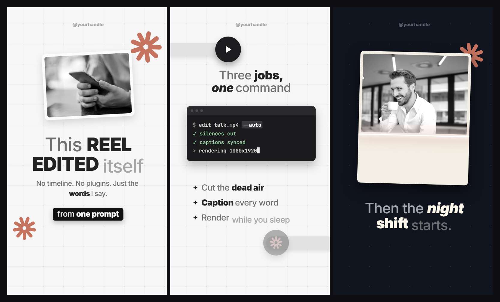

# Style: PAPER

A faceless explainer style that looks like motion design from a pro editing app. One clean paper
stage, and objects visit it: cards, terminals, badges, photos, little starbursts. Every word you
say lands on screen at the exact moment you say it. Nothing is ever fully still, nothing just
fades, and there is no music: soft sound effects are the rhythm.

**Format:** vertical reel, 1080 x 1920, 30 fps.
**You need:** a voiceover with word timestamps (any transcriber that gives per-word times), the
real things you talk about (screenshots, screen recordings, photos), and a small set of soft
sound effects (ticks, pops, whooshes, paper sounds, a low swell).

**How to build it:** say "build reel N in the paper style" (the `reel-build` skill). Claude
builds every scene in ravyn from regular clips (your footage, images, text, shapes, keyframes,
captions) following this spec, so you still open it in ravyn, leave notes on the frame and render
from there. ravyn's one-click preset is only the facecam window; everything else here is clips.

## The seven rules

1. **One world, visited by objects.** Objects enter the stage and leave it. They are never labels
   pasted on top. The ground colour can follow the story (see Grounds), but the physics never
   change: soft shadows, transform-only motion, slow drift.
2. **Text is word karaoke.** Every on-screen sentence mirrors the voiceover, and every word lands
   on its own timestamp. One word = one small event.
3. **Motion is transform-only, with life.** Things slide or scale in. Nothing enters by fade alone.
   Nothing is ever fully still.
4. **Scene changes are refocuses**, with one allowed hard cut (see Movement).
5. **Depth comes from shadows, never borders.** No outlines, no strokes, no filled boxes, with one
   exception: a single black pill per scene for the key phrase.
6. **No music bed.** Sound effects are the rhythm.
7. **Monochrome plus one accent.** Paper, ink and greys, and exactly one accent colour that carries
   all decoration. Real screenshots and photos keep their own colours: they read as objects
   photographed on the stage.

## Scene rules

### The intro (first ~13 seconds)

This is the part that makes or breaks the reel.

1. **One sentence = one scene.** Each spoken sentence gets its own scene, with a real cut between
   (a refocus or a hard ground cut). Do not keep one stage and keep adding things to it.
2. **Text never piles up.** Each scene shows only its own sentence. That text leaves with the scene.
3. **One focal object per scene.** Prefer a real captured thing (a screenshot, a photo) over an
   invented prop.

Busy is not the same as changing. Seven things added to one stage still feels static. Six short
scenes with one thing each feels alive.

**Check:** count the scenes in your first 13 seconds and the sentences in your transcript. They
should match.

### The body

Scenes are longer here and can carry several sentences. But when a text block would pass about
2 lines or about 15 words, split the scene instead of growing the block.

## The element cast

Reuse these. They are the style's vocabulary.

| Element | What it is |
|---|---|
| **Karaoke lines** | Titles, sub-lines and bullets, built word by word on the voice |
| **Sparkle bullets** | A small 4-point sparkle in ink before each bullet line |
| **Starbursts** | 9 rounded petals in the accent colour, in a corner, slowly drifting and turning |
| **Props** | 3D-render style objects, made grayscale, with a soft baked drop shadow, in a corner |
| **Badge on rail** | A black circle with a white icon, riding a light grey rounded bar that slides in from the screen edge. Dim it to opacity 0.32 to mean "off" |
| **Device mockups** | A terminal, phone or browser built in HTML, treated as a physical object. At least one per reel does something: types, switches state, highlights a line |
| **Film-strip rail** | A vertical dark strip creeping down the frame with white cards attached |
| **Card piles** | State lands ON the object: the pile grows, sags, strains. Never a label saying so |
| **The black pill** | One per scene, max. White text, radius about 14, rises in (never slams in) |

### Photo and person devices

| Device | What happens | Use it for |
|---|---|---|
| **The develop** | A dark negative fades into the full image like a darkroom print, a low swell under it | Slow reveals, mystery |
| **Coverflow** | Images stand in 3D like records in a crate; the one you name turns to face the camera | Browsing options, tool roundups |
| **The scan** | A bright line sweeps down; the image exists only where the line has passed | Evidence arriving, leaks |
| **The riser** | A person photo with the background removed rises from the bottom edge with overshoot, then floats | Introducing anyone |
| **The loom** | That same cut-out photo grows slowly through the whole beat until it towers | Power, "the biggest player" |
| **The halo** | The cut-out floats, a slow accent starburst spins behind the head, the name lands under it | Hero introductions |
| **The echo** | Accent-coloured copies step out from behind the cut-out like a motion trail | Momentum, influence |

## Movement

**Entries:** slide or scale in over **0.5 to 0.7 s** with a small overshoot (`back.out(1.1)` to
`back.out(1.4)`). The black pill rises in: from y +18 and scale 0.94, over 0.42 s. Bullet sparkles
pop from scale 0.4 to 1 over 0.4 s.

**Idle drift:** every resting object drifts on a slow sine, **4 to 9 px over 2.6 to 3.6 s**. The
background grid also creeps very slowly the whole reel (about 18 px across 48 s). Pause at any
second: if anything is pixel-frozen, add drift.

**Badges on rails:** the rail slides in from off-screen over 0.7 s (`power3.out`), the badge rides
it with 0.78 s `back.out(1.15)`.

**Scene change, the refocus (default):** the outgoing scene blurs from 0 to about **16 px** and
scales to **1.045** over about **0.5 s**. The incoming scene starts blurred and scaled and resolves
over about **0.55 s**. A low sub swell sits under it. Never fade to an empty frame.

**Scene change, the hard ground cut (the one exception):** when the ground colour itself changes
on an emphasis word, just set the new ground on that word's timestamp. No wipe, no crossfade. Use
it for the intro's sentence-per-scene cuts and for a deliberate slam. Refocus everything else.

## Karaoke text

- A new word arrives **light grey** (`#8A8A8A` on light grounds, `#8E8E8E` on dark), rises a few
  pixels into place, and settles to its final colour.
- **Keywords** settle to heavy ink (Inter 800 or 900).
- **Connector words** (the, a, of, with) stay mid grey, regular weight (Inter 500).
- **Action words** go italic.
- Section names and mega keywords go in CAPS.
- Every word must land within **0.1 s** of its voiceover timestamp.

## Look

| Token | Value | Use |
|---|---|---|
| Paper | `#F6F6F6` | the stage. The ending may dip to `#ECECEC` with a soft vignette |
| Ink | `#232323` | settled text, icons |
| Mid | `#6F6F6F` | connector words, secondary text |
| Grey-in | `#8A8A8A` light, `#8E8E8E` dark | the colour a word arrives in |
| Accent | one per reel, for example `#C5735F` terracotta | starbursts and decoration ONLY, never text |
| Rail | `#E2E2E2` | badge rails, dividers |
| Card | `#FBFBFB` | white cards, radius 16 to 24 px |
| Pill | `#111111` | the one black pill per scene |
| Grid | `rgba(35,35,35,.045)` lines, `rgba(35,35,35,.10)` dots | dotted cross grid, 135 px cells, always drifting slightly |
| Shadow | `0 18px 40px rgba(0,0,0,.12)` family | every card, prop and badge |

**Fonts:** Inter for everything (500 body, 800 titles, 900 mega words), tight leading (about
1.05 on titles), letter spacing -0.02em. JetBrains Mono only inside terminals and code.

**Sizes that work:** hook title 126 px, sub-line 44 to 46 px, pill text 48 px, bullet lines about
56 px, badge 172 px with an 84 px tall rail.

The accent follows the topic. Everything else never changes.

## Grounds

The stage is paper by default, but the ground can follow the story the way the accent follows the
topic. Change ground only during a refocus or on a hard ground cut. Re-check ink and card contrast
on every ground.

| Ground | Value | When |
|---|---|---|
| Paper (default) | `#F6F6F6` | everything, unless the story earns another |
| Dark | `#141416` + light dot grid | night beats, dread |
| Graph | `#F5F6F2` + squared grid `rgba(47,125,90,.14)` | numbers, charts, tutorials |
| Blueprint | `#16222E` + drafting grid `rgba(130,180,220,.16)` | how a system works |
| Midnight | `#10141E`, cream cards | big claims, money at night |
| Forest | `#121812`, mint-white cards | growth and money on dark |
| Wine | `#1D0F13`, blush-white cards | danger and drama, without a red alarm screen |
| Velvet | `#171126`, lavender-white cards | premium launches, "the expensive tier" |
| Petrol | `#0E1B1D`, sea-white cards | research, deep dives |
| Espresso | `#1A130D`, cream cards | warm, late-night personal stories |
| Plum | `#1D0F1B`, rose-white cards | culture and creator topics after dark |
| Storm | `#15181D`, cool-white cards | the neutral dark when no hue fits |

Every dark ground follows one recipe: near-black tinted with ONE hue, warm-white cards glowing on
top, a light dot grid at low opacity, and deeper shadows than on light grounds.

## Sound

- **No music.** Voiceover plus sound effects only. If a music bed crept in, take it out.
- About **one soft effect per visual event, roughly 45 per minute**: ticks or pops when words and
  bullets land, airy whooshes on slides, paper ticks on cards, a low swell into each scene.
- The voice is loud, dry and front and centre.
- Silence between events is confidence, not emptiness.

## Safe zone

Nothing important below **y 1700**. Instagram and TikTok put their buttons and caption there.
If you use a handle watermark, keep it small and light grey (`#A4A4A4`, Inter 800, 30 px), centred
near the top at about y 96.

## Checklist before you render

- [ ] First 13 seconds: scene count matches sentence count
- [ ] No text block over about 2 lines or 15 words; split the scene instead
- [ ] Scrub 5 random words: each lands within 0.1 s of the voice
- [ ] Pause anywhere: nothing on screen is frozen
- [ ] No borders, outlines or filled boxes; at most one black pill per scene
- [ ] One accent colour, on decoration only
- [ ] Every scene change is a refocus or a hard ground cut, never a fade to empty
- [ ] Voice and sound effects only, no music
- [ ] Every audio element has an `id` (in HyperFrames, audio without one renders silent)
- [ ] Nothing important below y 1700
