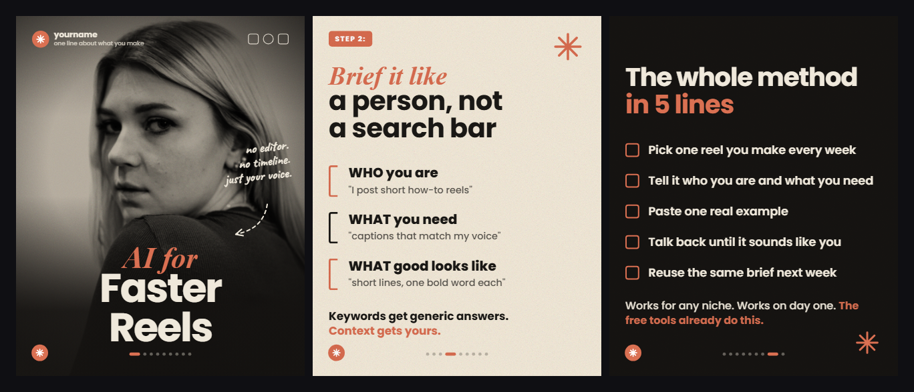

# Style: STEPS

An editorial carousel style for how-to posts. It looks like every slide is a different design, but
it is one style with a moving layout. The type, the palette, the grain and the fixed furniture stay
the same on every slide, so the post reads as one magazine. The layout changes on every swipe, so
nobody gets bored. Ten slides that share one layout feel like a template. This does not.

**Format:** carousel post, 4:5, 1080 x 1350 per slide, about 10 slides. Works on Instagram and LinkedIn.
**You need:** a how-to with 3 to 5 real steps, one or two strong photos (one with a person looking
at the camera for the cover), and a keyword people can comment.

**How to build it:** say "make a carousel in the steps style about <topic>". Claude writes one
HTML file per slide (1080 x 1350, fonts from `studio/fonts/`) into `studio/posts/<slug>/`, then
`node tools/shoot.mjs posts/<slug>` (from `studio/`) turns every slide into a PNG. Full recipe:
`docs/POSTS.md`.

## How it works: constants and variables

The style has two layers:

- **Constants:** on every slide, never changed. Type pairing, palette, texture, furniture.
- **Variables:** the layout. It MUST change from one slide to the next.

Your eye reads type, colour, texture and furniture as "the same brand", and reads the layout as
rhythm. Lock the first four and every new layout looks like a new page of the same magazine.

## The four constants (every slide)

### 1. The type pairing

- **Accent line:** an italic high-contrast serif (Playfair Display Italic). Lowercase, elegant, in the
  accent colour. Usually the action: *"Brief it like"*.
- **Payoff line:** a heavy geometric sans (Poppins 700 or 800), stacked right under the serif line or
  slightly overlapping it. Usually the thing: **"a person, not a search bar"**.
- **Body copy:** the same sans at a lighter weight (Poppins 500), in cream, with **bold spans** on the
  key phrases. Short sentences.
- Up to two slides may drop the serif and go all sans for punch (the checklist is one). Never drop
  the sans.
- Poppins runs wide. Check every headline and list row for an ugly wrap in the export.

### 2. The palette

- **One accent owns the post.** You may open with one secondary colour on the cover and the slide
  after it, then the accent takes over and never leaves. Never a third colour.
- **At most one paper slide per post.** Same accent, flipped to a light ground. It reads like a
  magazine's paper insert and resets the eye halfway through.
- You can change the accent to match the topic, but keep one colour family per post.

### 3. The texture

- **Film grain on every slide**, dark and paper alike. No flat digital black.
- **Photos are always treated, never raw.** Duotone or halftone cutouts collaged onto the ground, or
  full bleed with a heavy vignette when the photo carries the slide. Raw stock photos break the
  magazine feel faster than anything else.
- **Hand-drawn garnish:** dashed arrows, a starburst asterisk, a swipe-hand icon, a handwritten note.
  One or two per slide, never more.

### 4. The furniture (fixed positions, every slide)

- **STEP N pill** top left on every step slide: a small accent-filled rounded pill in caps
  (`STEP 2:`). This is the only filled box in the style.
- **Your logo mark** bottom left, every slide.
- **Dot pager** bottom centre, the current dot lit (a longer accent dash).
- **Cover only:** a brand header top left (mark, name, one-line description), social icons top right.

Furniture never moves. Overlay two slides and the pill, mark and pager must line up exactly. This is
the strongest "same magazine" signal in the whole style.

## The variable: layout types

**No two slides in a row share a layout.**

| | Layout | What is on it |
|---|---|---|
| A | **Magazine cover** | Full-bleed photo of a person making eye contact. A giant cream sans title over the lower half of the photo (body, never face). A small handwritten note plus a dashed arrow that opens a question. Brand header and socials. |
| B | **Manifesto** | A giant cream statement filling the slide, one collage cutout in a corner, the last line in the accent ("This one is different."), a swipe cue |
| C | **Photo editorial** | Type pairing up top, a short body block, a treated full-bleed photo owning the lower half, a white rounded caption pill sitting on the photo |
| D | **Thumbnail trio** | Three rounded mini cards in a row, a one-word label under each, a takeaway line below |
| E | **Paper diagram** | The one light slide. A vertical timeline or bracket diagram in accent and ink, bold list items, a footer line |
| F | **Collage text** | A text column with bold spans on one side, halftone cutout objects stacked in the opposite corner |
| G | **Card row + photo strip** | Three thin-outlined dark cards, one big bold statement, a black and white photo strip at the bottom |
| H | **Checklist** | A two-line all-sans headline (cream, then accent), a checkbox list with accent boxes, a closing line with an accent span |
| I | **Logo CTA** | Your logo mark, big and centred, and one bold line: the comment ask |

You can invent new layouts. Add one only after you have seen it work in a real post.

## The post shape

About 10 slides:

1. **Cover** (A): the hook. The handwritten note opens a loop.
2. **Manifesto** (B): the problem. Ends on the accent promise line.
3. to 7. **The steps** (rotate C, D, E, F, G): each one worth more than the last, STEP pills counting up.
8. **Recap checklist** (H): the whole method on one slide. This is the slide people save.
9. **CTA** (I): "Comment KEYWORD" with your logo mark centred.

## Look

| Token | Value | Use |
|---|---|---|
| ground | `#141210` | the near-black ground on most slides |
| cream | `#EFE8DA` | headlines and body text on dark |
| accent | `#D96C4F` terracotta | serif lines, pills, diagrams, starbursts, bold CTA spans |
| paper | `#F3EAD9` | the ground of the one paper slide |
| ink | `#1A1815` | text on the paper slide |
| Accent font | Playfair Display Italic 700 | the serif accent line |
| Payoff font | Poppins 700 / 800 | headlines, list items |
| Body font | Poppins 500, bold spans in 700 | body copy |
| Note font | Caveat 700 | handwritten notes on the cover |

Starting sizes at 1080 x 1350 (adjust to fit, keep the ratios):

| Element | Size |
|---|---|
| Cover title (sans) | about 150 px |
| Cover accent line (serif) | about 110 px |
| Slide headline (serif + sans) | about 96 to 100 px each |
| List items | about 44 to 50 px |
| Body copy | about 36 to 42 px |
| STEP pill text | about 26 px, caps, letter spacing 0.14em |
| Side margin | 60 px |

## Copy rules

- Short declarative sentences. One idea each.
- Bold the payoff phrase in every body block. One accent span per closing line.
- Real content only. No invented numbers, honest counts, real examples.

## Sound

None. It is a still post. If the platform lets you add music to a carousel, keep it quiet and simple.

## Safe zone

- Keep **60 px** clear on the left and right. The pill, the mark and the pager all sit on fixed spots
  inside that margin.
- **Never cover a face.** If a person is on a slide, the title and notes go over the body or beside
  the head. Eyes, nose, mouth and chin stay fully visible, the CTA included.

## Checklist before you post

- [ ] All four constants on EVERY slide: type pairing, palette, grain, furniture
- [ ] No two slides in a row share a layout
- [ ] One accent family in the body of the post (one intro secondary at most, then gone)
- [ ] At most one paper slide
- [ ] Furniture in identical positions on every slide (overlay two and look)
- [ ] Every photo is treated: duotone, halftone or heavy vignette. No raw stock
- [ ] Face check on any slide with a person: eyes, nose, mouth, chin all visible
- [ ] No headline or list row wraps badly
- [ ] No long dashes anywhere in the copy
