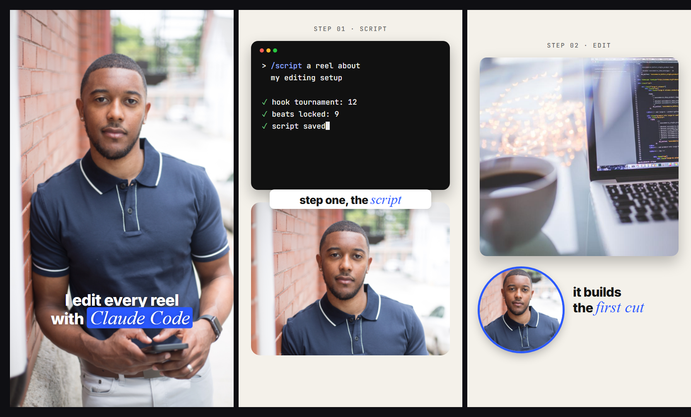

# Style: WINDOW

A facecam style for people who want their face in the reel. No cutout, no green screen, no
background removal. Your camera is a **window** that changes shape, and the scenes are built
around it.

**Format:** vertical reel, 1080 x 1920, 30 fps.
**You need:** a talking-head video of yourself (phone is fine) and the things you want to show
(screen recordings, screenshots, logos, numbers).

## The three scene types

Every reel uses all three. That is what keeps it from feeling like one long talking head.

| Type | What is on screen | Captions |
|---|---|---|
| **FULL FACE** | Your video fills the frame. Nothing else. | White, bold, centred at about y 1390, under your chin |
| **FACE + ELEMENT** | Your window shares the frame with one element (see the two layouts below) | Dark text on a white pill, sitting on the seam between the window and the element |
| **ELEMENTS ONLY** | Your window is gone. The element gets the whole frame on the plain ground. | Dark text, centred under the element |

**Sequence rules:**

1. All three types appear in every reel.
2. No type runs more than 4 scenes in a row.
3. An ELEMENTS ONLY stretch stays under 8 seconds. People came for a person.
4. Open on FULL FACE (the hook) and close on FULL FACE (the call to action).

A typical 30 second reel: `F F S E S F E S S F` (F = full face, S = face + element, E = elements only).

## The two FACE + ELEMENT layouts

### STACK (the default)

- Your window sits in the bottom half: x 60, y 930, 960 x 740, corner radius 44.
- The element sits in the top half: x 60, y 150, 960 wide, up to 720 tall.
- Crop the window so your eyes sit about one third down from its top edge.
- The caption pill sits on the seam between the two, overlapping both by a little.

### BUBBLE (when the screen is the star)

Use it for screen recordings, long terminal output, a full web page: anything that needs room.

- Your window becomes a circle: 400 x 400, x 60, y 1250, with a 10 px ring in the accent colour.
- The element fills the frame above it: x 60, y 230, 960 x 960.
- The caption sits to the right of the bubble, left aligned, two short lines.

### HEADROOM (optional, only if your shot allows it)

If your camera shows a lot of empty wall or ceiling above your head, you can skip the window
completely: keep your video full frame and float the element in that empty space
(x 70, y 110, 940 wide, never lower than the top of your head). The easiest layout of all,
but it only works when the shot has the room. Check one frame before you choose it.

## Movement: the window IS the transition

The best thing about this style: you never need a transition effect. The window moving is
the transition.

- **FULL FACE to STACK:** the full frame shrinks into the bottom window (0.5 s, ease out with a
  small overshoot) while the element slides down into the space it left.
- **STACK to BUBBLE:** the window shrinks into the circle and slides to the corner.
- **Anything to ELEMENTS ONLY:** the window drops out of the bottom of the frame.
- **Back to FULL FACE:** the window grows back to fill the frame.

Other rules:

1. **Nothing just fades.** Everything enters with a reason (slides, grows, types in) and leaves
   moving.
2. **The camera stays alive.** Every screenshot and recording slowly pushes in, about 1.00 to
   1.10 over its time on screen. Nothing sits completely still.
3. **Build the interface, do not just show it.** Commands type in, rows land one at a time,
   checkmarks tick on the word you say.
4. **Big type only on what matters.** Numbers, the key claim, the punchline. Three or four
   moments a reel, not every sentence.
5. **No cheese.** No 3D spins, no glow, no bouncing text, no preset transitions.

## Look

| Token | Value | Use |
|---|---|---|
| Ground | `#F4F1EA` warm off-white | behind every non-face scene |
| Ink | `#141414` | captions on the ground |
| Accent | `#2B59FF` (pick your own) | one emphasis word per caption, the bubble ring |
| Caption font | Inter 800, about 76 px | everything you say |
| Emphasis font | Instrument Serif Italic, about 92 px | the one word that matters in a caption |
| Label font | JetBrains Mono 500, 30 px, letter spacing 0.14em | small eyebrows like `STEP 01 · SCRIPT` |

- Elements live on cards with a 34 px radius and a soft shadow. No borders.
- One accent colour per reel. If the reel is about a brand, use that brand's colour.
- On FULL FACE, the emphasis word gets the accent as a highlight box behind white text.

## Safe zone

Nothing important below **y 1700**. Instagram and TikTok put their buttons and caption there.
Keep captions and faces above it.

## Captions

- Every word you say, in order, timed to your voice.
- Two lines maximum, about 4 to 7 words.
- One emphasis word per caption, in the serif italic and the accent colour.

## Sound

- Your voice is the loudest thing, always.
- One soft sound effect per visual event (a click when a row lands, a whoosh when the window
  moves). Not on every word.
- Music is optional and stays far under the voice.

## Checklist before you render

- [ ] All three scene types are in the reel
- [ ] No type runs more than 4 scenes in a row
- [ ] Nothing important below y 1700
- [ ] Every scene change is the window moving, not a preset transition
- [ ] Every screenshot or recording is slowly moving
- [ ] Captions match the voice word for word
